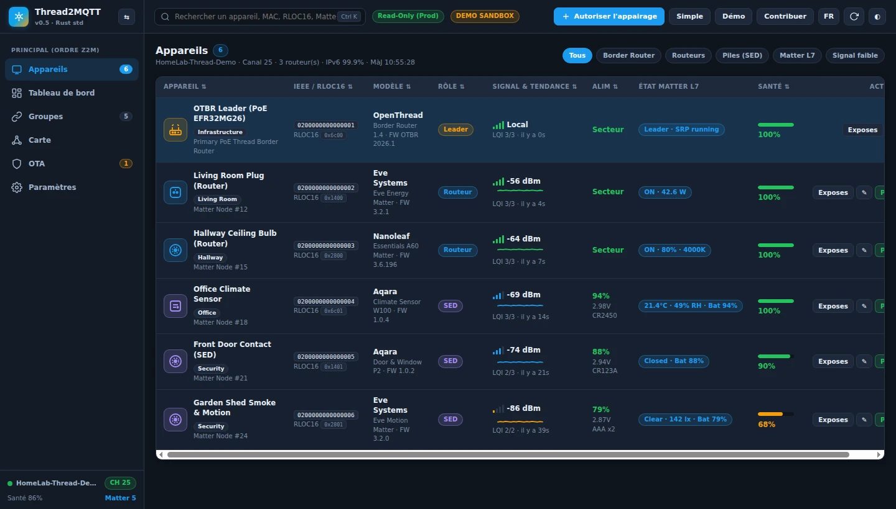
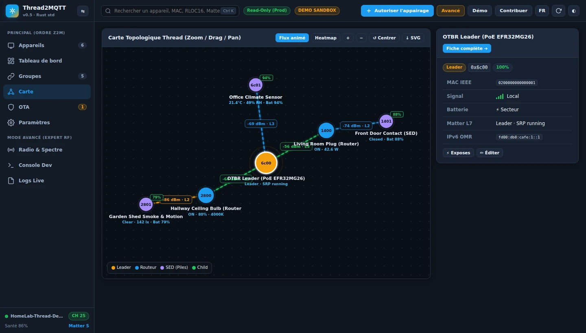
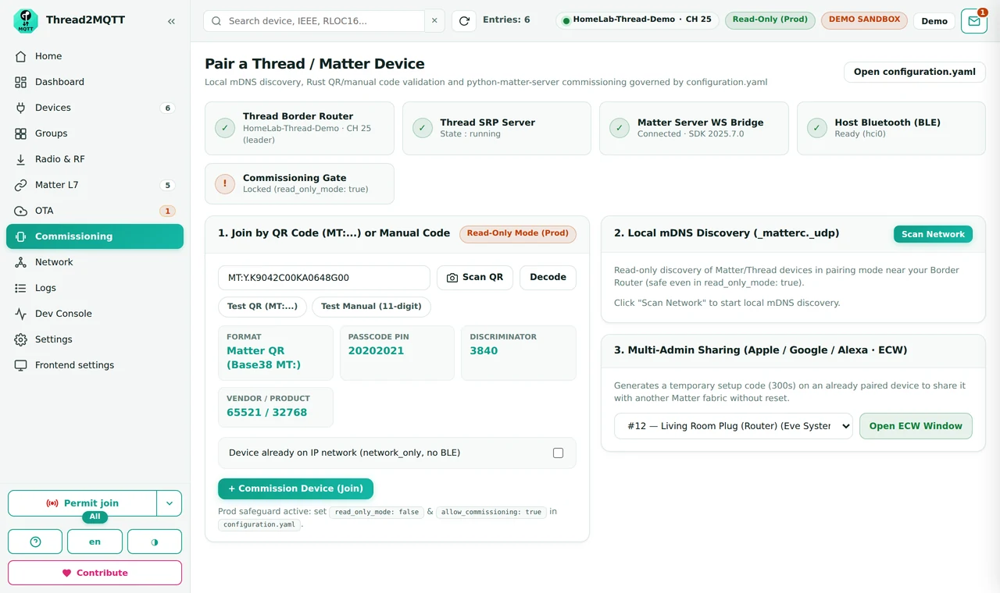

# Thread2MQTT — Pure-Rust Thread & Matter Debugger + Home Assistant MQTT Bridge

[](LICENSE)
[](https://www.rust-lang.org/)
[](Cargo.toml)
[](https://www.home-assistant.io/)

**Zigbee2MQTT-style Web UI, mesh topology debugger, Home Assistant MQTT Auto-Discovery, and Prometheus exporter for Thread (OTBR) + Matter-over-Thread** — compiled as a single static Rust binary (`< 1 MB`, `< 1 MB` RAM, **0 external crates**, **0 web CDNs**).

- **Architecture & live homelab write-up:** [blog.ravindra-job.fr](https://blog.ravindra-job.fr/iot/thread2mqtt-rust-equivalent-zigbee2mqtt-thread-matter-home-assistant/)

## Live Preview (`--demo` mode)



| Interactive Mesh Map (Advanced Mode) | Permit Join, QR Camera & Server BLE Check |
| :---: | :---: |
|  |  |

## Why Thread2MQTT?

Home Assistant + `python-matter-server` controls Matter Layer 7, but exposes **zero Thread radio visibility** (no mesh map, no RSSI history, no 2.4 GHz spectrum, no MAC/IPv6 drop counters, no SRP leases).

**Thread2MQTT runs as a non-blocking sidecar (`0 ms` added latency)** querying OTBR (`REST` + `ot-ctl`) and `python-matter-server` (`:5580/ws`) in parallel:


| Capability | Zigbee2MQTT | `python-matter-server` | **Thread2MQTT v0.5 (Rust)** |
| :--- | :---: | :---: | :---: |
| Familiar Z2M Menu + Simple / Advanced Toggle | Yes | No | **Yes (1-click)** |
| Interactive Mesh Map + 60-pt RSSI Sparklines | Static | No | **Animated SVG + Heatmap** |
| Thread L2/L3 (SRP) ↔ Matter L7 Correlation | N/A | No | **Automatic** |
| Permit Join + Native QR Camera + Server BLE Detect | Yes | Basic UI | **Built-in (`configuration.yaml`)** |
| 2.4 GHz Energy Scan + MAC/IPv6 Counters | Basic | No | **Built-in (Advanced Mode)** |
| Prometheus `/metrics` + Grafana + Alert Rules | External | No | **Built-in (`monitoring/`)** |
| Runtime Footprint | `~140 MB` (Node) | `~100 MB` (Python) | **`< 1 MB` RSS (`0` crates)** |

## Quick Start

### 1. Instant Demo (Zero Hardware)

```bash
git clone https://github.com/ravindrajob/thread2mqtt.git
cd thread2mqtt
cargo test
cargo run -- --demo --bind 127.0.0.1:8099
# Web UI: http://127.0.0.1:8099/
```

### 2. Production (`configuration.yaml`)

```bash
cp configuration.yaml.example data/configuration.yaml
# Edit OTBR REST URL, Matter WS URL, and optional MQTT broker
docker compose up -d
```

Open **Settings → Detect local hardware** (`GET /api/hardware/scan`) to inspect host Bluetooth adapters (`hci0`..`hciN`), USB Thread RCP serial paths, and generate the `matter-server` `--bluetooth-adapter` Compose snippet.

### 3. Enable Commissioning & Controls (Opt-In)

Thread2MQTT ships **fail-closed (`read_only_mode: true`)** so live networks can be audited with zero mutation risk. To enable joining, Multi-Admin sharing (ECW), and `Identify` / `OnOff` commands, explicitly set in `data/configuration.yaml`:

```yaml
matter:
  ws_url: "ws://127.0.0.1:5580/ws"
  allow_commissioning: true

advanced:
  read_only_mode: false
```

## Monitoring (`monitoring/`)

- `GET /metrics` — Prometheus gauges (`thread2mqtt_mesh_health_score`, `thread2mqtt_node_rssi_dbm`, `thread2mqtt_node_battery_percent`, `thread2mqtt_mac_ack_rate_percent`, `thread2mqtt_ip_delivery_ratio`).
- `GET /api/alerts` — JSON alerts for Home Assistant REST sensors.
- Ready-to-import [`monitoring/grafana-dashboard.json`](monitoring/grafana-dashboard.json) & [`monitoring/prometheus-alerts.yml`](monitoring/prometheus-alerts.yml).

## Security Defaults

- **0 external crates** (custom YAML, RFC 6455 WS, RFC 8259 JSON, Base38/Verhoeff Matter decoder, MQTT 3.1.1 in pure `std`) → zero third-party supply-chain CVEs.
- **Secret masking:** `networkKey` & `pskc` masked at ingestion and stripped before MQTT/log output.
- **Hardened container:** `USER 1000:1000`, `read_only: true`, `cap_drop: [ALL]`, `no-new-privileges:true`, `mem_limit: 32m`, optional `frontend.auth_token`.

## Contributing & License

See [`CONTRIBUTING.md`](CONTRIBUTING.md) and [`AGENTS.md`](AGENTS.md). Independent project inspired by Zigbee2MQTT/WindFront ergonomics (not affiliated). Licensed under [MIT](LICENSE) — **Ravindra JOB**.
