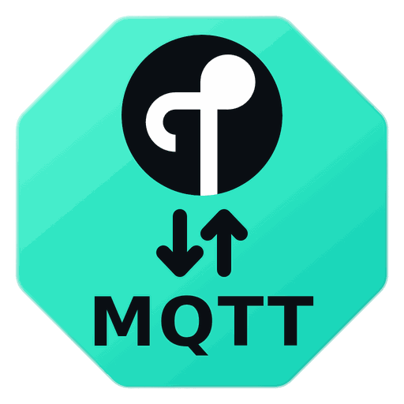
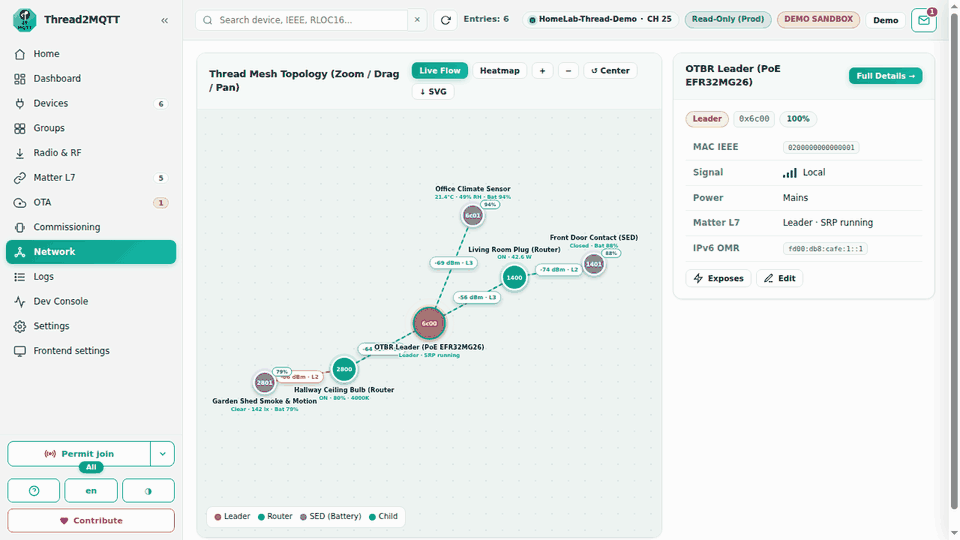
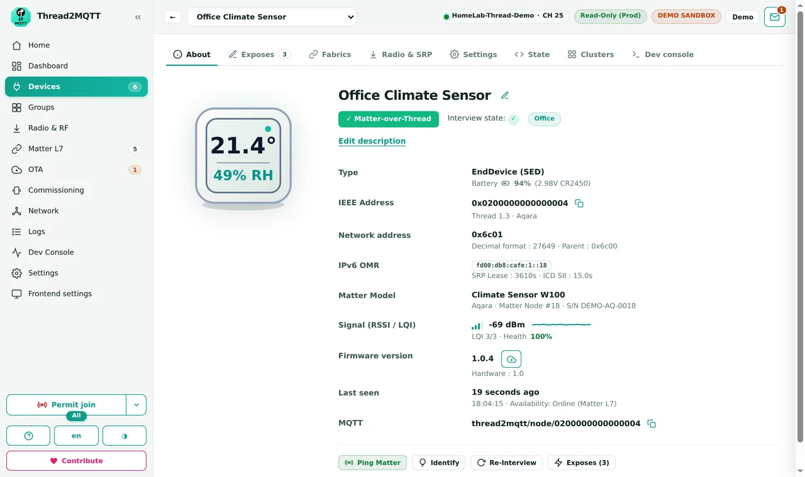
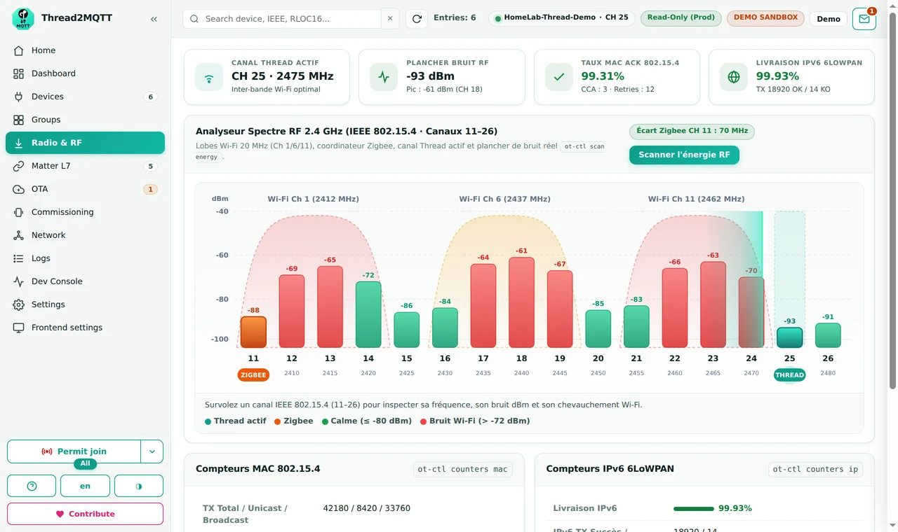
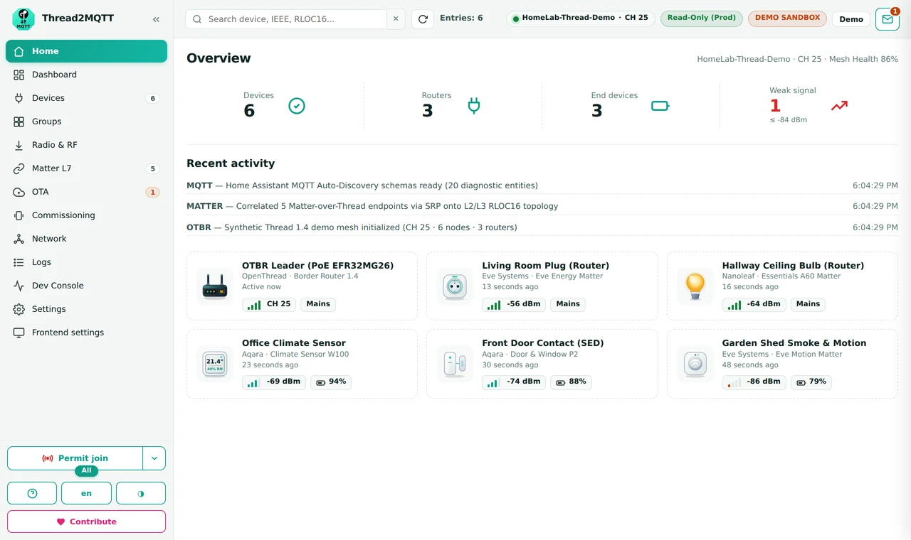
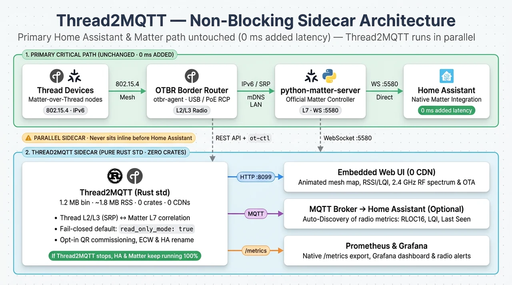

<p align="center">
  
</p>

<h1 align="center">Thread2MQTT</h1>

<p align="center">
  <strong>Open-source Rust Thread &amp; Matter Debugger + Home Assistant MQTT Bridge</strong><br/>
  Embedded Web UI · Animated Mesh Map · 2.4 GHz RF Spectrum · <code>~1.8 MB</code> RSS · <strong>0 external crates</strong> · <strong>0 CDNs</strong>
</p>

<p align="center">
  <a href="LICENSE"></a>
  <a href="https://www.rust-lang.org/"></a>
  <a href="Cargo.toml"></a>
  <a href="https://www.home-assistant.io/"></a>
</p>

- **Technical write-up & bench:** [blog.ravindra-job.fr/iot/thread2mqtt-rust-equivalent-zigbee2mqtt-thread-matter-home-assistant/](https://blog.ravindra-job.fr/iot/thread2mqtt-rust-equivalent-zigbee2mqtt-thread-matter-home-assistant/) · **Architecture & IPv6/Backup Guide:** [`docs/GUIDE.md`](docs/GUIDE.md) · **Changelog:** [`CHANGELOG.md`](CHANGELOG.md) · **Logo:** [`assets/logo.png`](assets/logo.png) / [`assets/logo.svg`](assets/logo.svg)

## Live Preview (`--demo` mode)




| Device Details (Exposes, Firmware, IPv6 OMR & Last Seen) | 2.4 GHz RF Spectrum Analyzer (Wi-Fi 1/6/11 + MAC/IPv6) |
| :---: | :---: |
|  |  |

| Home Overview & Recent Activity | Commissioning, Native QR Camera & Server BLE Check |
| :---: | :---: |
|  |  |

## Why Thread2MQTT?

Home Assistant + `python-matter-server` controls Matter Layer 7, but exposes **no Thread radio visibility** (no mesh map, no RSSI history, no Last Seen, no 2.4 GHz spectrum, no MAC/IPv6 drop counters, no SRP leases).

**Thread2MQTT runs as a non-blocking sidecar (`0 ms` added latency)** querying OTBR (`REST` + `ot-ctl`) and `python-matter-server` (`:5580/ws`) in parallel:



| Capability | `python-matter-server` | **Thread2MQTT v0.5 (Rust)** |
| :--- | :---: | :---: |
| Web UI with Device Inspector, `Permit join`, `Columns:` & live `Last Seen` | Basic | **Built-in (0 CDN)** |
| Animated Mesh Map + 60-pt RSSI Sparklines + Heatmap | No | **Built-in SVG** |
| Automatic Thread L2/L3 (SRP) to Matter L7 Correlation + 22+ CSA Clusters | Partial | **Automatic (0 converters)** |
| Commissioning + Native QR Camera + Host BLE/USB Detection | Basic UI | **Built-in (`configuration.yaml`)** |
| 2.4 GHz RF Energy Scan + MAC/IPv6 Counters + Read-only `ot-ctl` | No | **Built-in** |
| Prometheus `/metrics` + Grafana Dashboard + Alert Rules | No | **Built-in (`monitoring/`)** |
| Runtime Footprint | `~30-100 MB` (Python) | **`~1.8 MB` RSS (`1.2 MB` bin, `0` crates)** |

## Quick Start

### Option 1 - Prebuilt Multi-Arch Docker Image (`amd64` + `arm64`)

```bash
# Instant zero-hardware demo:
docker run --rm -p 127.0.0.1:8099:8099 ghcr.io/ravindrajob/thread2mqtt:latest --demo --bind 0.0.0.0:8099

# Production with configuration.yaml (pull GHCR or add `--build` to rebuild locally):
cp configuration.yaml.example data/configuration.yaml
docker compose up -d
```

### Option 2 - Build From Scratch (Pure Rust `std`, Zero Crates)

```bash
git clone https://github.com/ravindrajob/thread2mqtt.git && cd thread2mqtt
cargo test
cargo run --release -- --demo --bind 127.0.0.1:8099
```

Open **Settings -> Detect local hardware** (`GET /api/hardware/scan`) to inspect host Bluetooth adapters (`hci0`..`hciN`) and USB Thread RCP paths. Ships **fail-closed (`read_only_mode: true`)**; set `advanced.read_only_mode: false` and `matter.allow_commissioning: true` in `data/configuration.yaml` to opt in to commissioning and controls.

## Engineering Notes

- **64-bit Matter IDs vs `f64`:** Real `python-matter-server` snapshots carry 64-bit `compressed_fabric_id` integers that lose precision in float-backed JSON parsers; solved with exact `JsonVal::Uint(u64)` in `src/matter_ws.rs`.
- **Matter WS errors inside HTTP 200:** Commissioning and cluster calls return JSON `error_code` frames over an active WebSocket; `write_matter_reply` translates them to HTTP `502`.
- **Zero-crate constraint:** RFC 6455 WS, RFC 8259 JSON, Base38/Verhoeff (Matter Spec 5.1.4.1), and MQTT 3.1.1 are implemented directly on `std`, keeping the static binary at `1.2 MB` (including 6 embedded WebP assets) and live RSS around `~1.8 MB`.
- **Workflow:** Built and bench-tested against live `otbr-agent` + `python-matter-server` hardware (`16/16` unit tests). Full history in [`CHANGELOG.md`](CHANGELOG.md).

## Monitoring, CI/Releases & License

- `GET /metrics` (Prometheus), `GET /api/alerts`, [`monitoring/grafana-dashboard.json`](monitoring/grafana-dashboard.json), [`monitoring/prometheus-alerts.yml`](monitoring/prometheus-alerts.yml), multi-arch CI/Release [`.github/workflows/ci-release.yml`](.github/workflows/ci-release.yml).
- Secret masking on `networkKey` & `pskc`, hardened container (`USER 1000:1000`, `read_only: true`, `cap_drop: [ALL]`, `mem_limit: 64m`).
- See [`CONTRIBUTING.md`](CONTRIBUTING.md) and [`AGENTS.md`](AGENTS.md). Licensed under [MIT](LICENSE) - **Ravindra JOB**.
